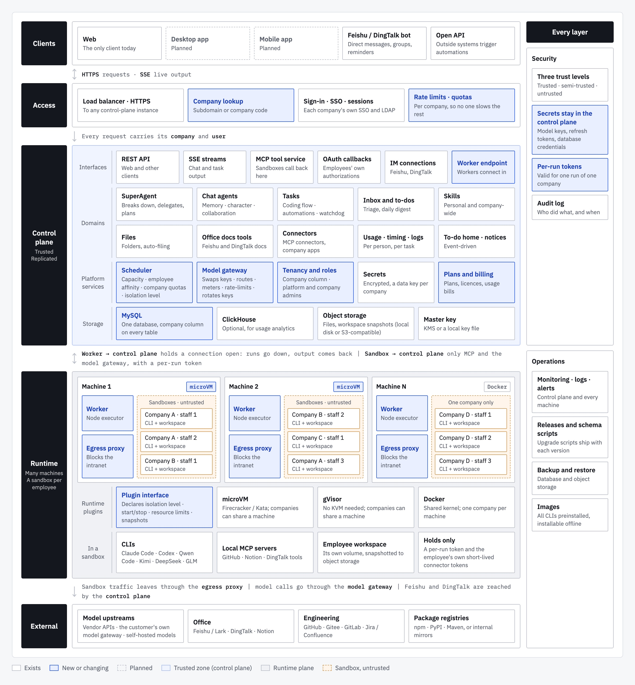

# 技术画图规范（统一分层卡片风格）

> 文档里画任何技术图时使用：架构总览、模块分层、流程、时序、数据模型、状态图，全部用同一套 HTML/SVG 分层卡片风格画，再用无头 Chrome 渲染成 PNG 图片交付，不用 Mermaid。附样例图、真实色值、源码骨架、渲染命令、各类图的画法和自查项。

# 技术画图规范（统一分层卡片风格）

## 总则
- 所有技术图用同一套视觉风格：先用 HTML/SVG 画，再**渲染成 PNG 图片交付**。不用 Mermaid，不在文档里内嵌 SVG。
- 风格以图 1 为准，源文件是仓库里的 `docs/prd/architecture-diagram-zh.html`。拿不准某个细节时，直接读这个文件照着写。
- 一份文档里的图要像同一个人画的：同样的字体、卡片、配色、图例。
- 一张图只讲一件事，卡片不超过 15 张；超过就拆成总览一张、细节一张。
- 图里的名字和正文、代码一致：类叫 `SkillService` 就写 `SkillService`。

样例：


图 1　样例：控制面与运行面分离的多租户架构

## 交付方式：统一用图片
- **每张图一个 PNG**，2 倍分辨率，白底。用 `file_save` 存进「文件」，文件名写图的内容，如「图 2 任务模块分层.png」。
- 文档里用图片引用：Markdown 写 ``；HTML 文档写 ``。
- 画图用的 HTML 源文件留在工作区，和 PNG 同名（`.html`），以后改图改源文件再重新渲染，不要在图片上修补。
- 图片里不放图题，图题写在文档里图片下面一行。

### 渲染命令
每张图单独一个 HTML 文件，页面里只放这一张图（不放标题、正文）。用本机 Chrome 无头模式截图：

```bash
"/Applications/Google Chrome.app/Contents/MacOS/Google Chrome" --headless=new --disable-gpu \
  --hide-scrollbars --force-device-scale-factor=2 --window-size=1240,900 \
  --screenshot=out.png file:///绝对路径/fig-2.html
```

- `--window-size` 的宽取图的宽度加左右留白（骨架里图宽 1200，取 1240）；高按内容估。
- 截完必须用 Read 打开 PNG 看一眼：底部被截断就加高重截，下面空白超过 40px 就减高重截，直到刚好包住。
- 服务器上没有 Chrome 时，用 `chromium` 或 `google-chrome` 同样参数；都没有就停下来告诉用户，不要退回 Mermaid。

## 色值和字体（取自源文件，照抄）

```css
:root {
  --paper: #f6f7f9;        /* 页面底 */
  --surface: #ffffff;      /* 卡片底 */
  --ink: #14171d;          /* 正文、层名块底 */
  --muted: #5a606c;        /* 副标题、说明 */
  --line: #dde0e6;
  --line-strong: #b9bec8;  /* 卡片边框 */
  --brand: #2457f5;        /* 新增：边框 */
  --brand-ink: #1a3fb8;    /* 新增：标题字 */
  --brand-soft: #e9effe;   /* 新增：底色 */
  --brand-line: #a9bdf8;   /* 可信区边框 */
  --trust-hi: #f0f4fe;     /* 可信区（控制面）底 */
  --trust-mid: #f0f1f4;    /* 运行面底 */
  --trust-low: #fff5ea;    /* 沙箱底 */
  --trust-low-line: #d99a55; /* 沙箱虚线框 */
  --font-ui: "IBM Plex Sans", "PingFang SC", "Hiragino Sans GB", "Microsoft YaHei", system-ui, sans-serif;
  --font-mono: "IBM Plex Mono", ui-monospace, Menlo, Consolas, monospace;
}
```

- 只用浅色主题，不做深色版本。
- 黑白灰为主；品牌蓝只用在「新增或要改的」；橙色只用在不可信区。
- 字号：层名 14px 粗体；卡片标题 13px 粗体（600）；卡片副标题 11.5px 灰色；连接说明 11.5px 等宽；图例 12.5px。只用两种字重：400 和 600。
- 卡片用无衬线字体，等宽字体只用在连接说明、类型标签和箭头文字上。
- 组件名、协议、产品名用原文（SuperAgent、Agent、MCP、SSE 不翻译）；中文文档的副标题全用中文。

## 源码骨架
分层类的图（总览、模块分层、流程泳道）直接用 HTML 网格写，下面是最小骨架，样式抄自源文件：

```html
<!doctype html><html lang="zh-CN"><head><meta charset="utf-8"><style>
:root{ /* 粘贴上面的色值 */ }
*{box-sizing:border-box} body{margin:0;background:#fff;color:var(--ink);font-family:var(--font-ui);padding:20px}
.arch{display:grid;grid-template-columns:minmax(0,1fr) 176px;gap:12px;width:1200px}
.stack{display:grid}
.layer{display:grid;grid-template-columns:92px minmax(0,1fr);gap:10px}
.layer-name{background:var(--ink);color:var(--paper);border-radius:3px;display:flex;flex-direction:column;align-items:center;justify-content:center;gap:3px;text-align:center;padding:10px 6px;font-weight:600;font-size:14px;line-height:1.3}
.layer-name small{font-weight:400;font-size:11px;opacity:.72}
.layer-body{border:1px solid var(--line-strong);background:var(--surface);border-radius:3px;padding:10px;display:grid;gap:8px}
.layer--control .layer-body{background:var(--trust-hi);border-color:var(--brand-line)}
.layer--run .layer-body{background:var(--trust-mid)}
.row{display:grid;gap:8px;grid-template-columns:repeat(var(--n,4),minmax(0,1fr))}
.group{display:grid;grid-template-columns:70px minmax(0,1fr);gap:8px}
.group-name{display:flex;align-items:center;justify-content:center;text-align:center;font-size:12px;color:var(--muted);border-right:1px solid var(--line-strong);padding-right:6px}
.cell{border:1px solid var(--line-strong);background:var(--surface);border-radius:2px;padding:7px 10px;min-height:46px;display:flex;flex-direction:column;justify-content:center;gap:1px}
.cell b{font-size:13px;font-weight:600;line-height:1.35}
.cell span{font-size:11.5px;color:var(--muted);line-height:1.4}
.cell--new{background:var(--brand-soft);border-color:var(--brand)} .cell--new b{color:var(--brand-ink)}
.cell--plan{background:transparent;border-style:dashed} .cell--plan b{color:var(--muted)}
.link{display:flex;align-items:center;gap:10px;margin-left:102px;padding:7px 0;font-family:var(--font-mono);font-size:11.5px;color:var(--muted)}
.link svg{width:10px;height:22px} .link svg path{stroke:var(--line-strong);fill:none;stroke-width:1.4}
.link b{font-weight:500;color:var(--ink)}
.side{display:grid;grid-template-rows:auto 1fr;gap:10px}
.side-title{background:var(--ink);color:var(--paper);border-radius:3px;text-align:center;font-weight:600;font-size:14px;padding:10px 6px}
.side-box{border:1px solid var(--line-strong);border-radius:3px;padding:10px;display:grid;gap:7px;align-content:start}
.legend{display:flex;flex-wrap:wrap;gap:8px 18px;font-size:12.5px;color:var(--muted);margin-top:12px}
.legend span{display:inline-flex;align-items:center;gap:7px}
.sw{width:18px;height:12px;border:1px solid var(--line-strong);background:var(--surface);display:inline-block}
.sw--new{background:var(--brand-soft);border-color:var(--brand)} .sw--plan{background:transparent;border-style:dashed}
.sw--hi{background:var(--trust-hi);border-color:var(--brand-line)} .sw--mid{background:var(--trust-mid)}
.sw--low{background:var(--trust-low);border:1px dashed var(--trust-low-line)}
</style></head><body>
<div class="arch">
  <div class="stack">
    <div class="layer">
      <div class="layer-name">L5 web</div>
      <div class="layer-body"><div class="row" style="--n:3">
        <div class="cell"><b>TaskController</b><span>只把 HTTP 转给 service</span></div>
        <div class="cell cell--new"><b>CostController</b><span>本次新增</span></div>
        <div class="cell cell--plan"><b>BudgetController</b><span>规划</span></div>
      </div></div>
    </div>
    <div class="link"><svg viewBox="0 0 10 22"><path d="M5 1v20M1.5 17 5 21l3.5-4"/></svg><span>调用 <b>TaskService</b> · 带 <b>company_id</b></span></div>
    <div class="layer layer--control">
      <div class="layer-name">L3 task<small>可信</small></div>
      <div class="layer-body">
        <div class="group"><div class="group-name">服务</div><div class="row" style="--n:3">
          <div class="cell"><b>TaskService</b><span>创建 · 调度 · 恢复</span></div>
          <div class="cell"><b>CodingHarness</b><span>编码七步</span></div>
          <div class="cell"><b>TaskWatchdog</b><span>卡住重试</span></div>
        </div></div>
      </div>
    </div>
  </div>
  <aside class="side">
    <div class="side-title">贯穿各层</div>
    <div class="side-box"><div class="cell"><b>TenantContext</b><span>所有查询按公司过滤</span></div></div>
  </aside>
</div>
<div class="legend">
  <span><i class="sw"></i>现有</span><span><i class="sw sw--new"></i>新增或要改造</span><span><i class="sw sw--plan"></i>规划中</span>
</div>
</body></html>
```

需要连线的图（部署、时序、数据模型、状态）用 SVG 画，类名和颜色照源文件「图 2 多机部署」那段：区域框 `zone-hi` / `zone-run` / `zone-low`，卡片 `box` / `box-new`，线 `ln`（灰）/ `ln-brand`（蓝）/ `ln-warm`（橙虚线），箭头用 `<marker>`，编号用深色小圆 `badge` 加白色等宽数字。

## 共用元素
所有类型的图都由下面几样东西拼成，不另造新元素。

### 卡片
- 每张卡片两行：第一行粗体写名字，第二行灰色小字写一句职责或现状。
- 第二行写清楚它做什么、到什么程度，不写「核心模块」这类空话。并列的几个点用「 · 」隔开。
- 同一行的卡片等宽、等高、等间距，一行 3–6 张。
- 一组同类实例（物理机 1 / 2 / N）用容器框套起来，右上角放等宽小标签写类型（`microVM`、`Docker`）；用 N 表示「还有更多」，不要画满。

### 层名列
- 左侧一列深色实心块，白字粗体写层名；需要时下面一行小字写性质，如「可信 · 多副本」。
- 层较大时，在层名列右边加一列灰色子行标签（接口、业务域、平台能力、存储），子行和卡片之间用细竖线隔开。

### 连接
- 层与层之间优先用**一行等宽说明**代替箭头：左边一个细箭头，后面写走什么。关键词加粗：协议名、身份字段、组件名。多件事并列用「 ｜ 」分开。
- 必须画箭头时（部署、流程、时序、状态），只用直线或折线，1.5px，箭头小而实心；需要说明的线用编号圆点，正文里按编号解释。线不交叉，交叉了就调整卡片位置或拆图。

### 用样式表达状态，不靠文字
| 样式 | 含义 |
|---|---|
| 白底、灰边框 | 已有 |
| 浅蓝底、品牌蓝边框、标题蓝字 | 新增或要改的 |
| 灰色虚线边框、标题变灰 | 规划中、还没做 |
| 整片浅蓝底 | 可信区（控制面） |
| 整片浅灰底 | 运行面 |
| 橙色虚线框、浅米黄底 | 不可信区（沙箱） |

状态色只用这几种。改造方案的图里，蓝色卡片就是这次要做的范围。出错、退回分支用灰色虚线箭头，不引入红色。

### 右侧贯穿栏和图例
- 横跨所有层的关注点（安全、运维、计费）放右侧窄栏，深色标题块「贯穿各层」下面分组放卡片。
- 最下面一行图例：小色块加文字。图里用到的每种样式都要在图例里出现，没用到的不放。

## 各类图怎么画
| 要表达 | 画法 |
|---|---|
| 整个系统的分层、部署、信任边界 | **总览图**：完全照图 1，用 HTML 网格。从上到下按请求方向排：客户端 → 接入 → 控制面 → 运行面 → 外部系统；一份文档最多一张 |
| 一个模块或子系统的分层 | **分层图**：用上面的骨架，只画相关几层；层名列写模块层级（L5 web、L3 task），卡片写类名；层间说明写谁调谁 |
| 多机部署、调用链路 | **部署图**：照源文件图 2，用 SVG；区域框表示信任区，编号圆点标出每条通信 |
| 处理流程、决策分支 | **流程图**：层名列换成泳道名（平台、开发模型、审查模型、用户），每条泳道一行阶段卡片从左到右；主路径实线箭头，退回和失败分支灰色虚线并在线上写条件 |
| 一次调用的先后 | **时序图**：SVG；参与者是顶部一排卡片，向下画灰色细虚线作生命线；消息是水平箭头，线上用等宽字写「1 确认提纲」；返回用虚线箭头；循环、分支用浅灰底框套住，左上角等宽标签写 `loop`、`alt` |
| 表和表的关系 | **数据模型图**：每张表一张卡片，第一行表名，第二行写主键和关键字段（`id · company_id · task_id`）；新表、新字段用蓝框；关系用折线，两端写 `1`、`N` |
| 对象的状态变化 | **状态图**：每个状态一张卡片，第二行写进入条件；正常流转实线，异常和人工介入虚线；终态卡片用深色底白字 |

## 编号和标题
- 每张图下面一行写图题：`图 2　任务模块分层`。编号从 1 起依次递增。
- 正文里至少有一处引用：「见图 2」。没人引用的图删掉。
- 图题写这张图的结论或范围，不写「架构图」「流程图」。

## 画完自查
- 打开渲染出的 PNG 看过：没有截断、没有大片空白、文字没有挤成三行以上。
- 每一层、每条泳道在左侧都有名字；每种样式、线型都在图例里有解释。
- 卡片名和正文、代码里的名字一致。
- 同一文档里所有图的字号、卡片尺寸、配色一致。
- 没有交叉的线，没有只靠文字「（新增）」标注的新组件。
- 读者只看图能说出要点：总览图看出请求从哪进、在哪执行、哪里是信任边界、这次改哪几块；流程图看出主路径和退回条件；时序图看出谁先调谁。

## 好和坏
- 坏：同一份文档里总览图是这套风格，流程图是 Mermaid 默认配色，两种字体两种箭头。
- 坏：把 SVG 直接贴进 Markdown，读者那边显示成一堆代码。
- 坏：一张图 28 张卡片，没有编号，正文没提到它，卡片叫「服务 A」「模块 B」。
- 坏：新增的组件和已有的长得一样，只在文字里写「（新增）」；箭头交叉成一团。
- 好：流程图只画 6 个阶段，泳道名在左侧深色列，退回分支是灰色虚线，线上写「审查不通过」。
- 好：总览图里蓝框就是本次改动，层间一行等宽说明写清走什么协议、带什么身份。
