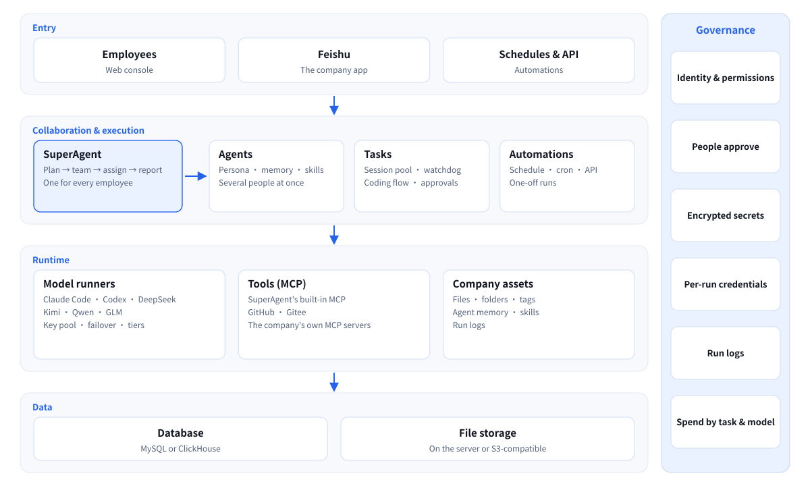

<p align="center">
  
</p>

**AI collaborative work system for companies, not personal assistants.** Everyone works with AI in one system, and the work becomes the company's assets. Open source and self-hosted.

[Website](https://oryx-labs.github.io/SuperAgent/) · [Live demo](http://117.72.92.117:18081/login) · [中文](https://oryx-labs.github.io/SuperAgent/zh/)

## What is SuperAgent?

Most AI agents today are personal assistants. They make one person faster, keep the work in that person's account, and leave with them.

SuperAgent is designed from the company's side instead: the company and its employees. Companies need AI that actually gets used. It has to be useful, affordable, and able to do any kind of work. SuperAgent is a system the company deploys once for everyone. Employees get AI from their first day, everyone works in the same place, and that work automatically becomes company assets that don't disappear when people change.

| | Personal AI assistants | SuperAgent |
| --- | --- | --- |
| Who it serves | One person | The whole company and its employees |
| Where the work goes | A personal account; leaves with the person | Company assets that accumulate automatically |
| Working together | Everyone separately | Share Agents; a SuperAgent that runs a team |
| Cost | Every employee subscribes; tokens wasted | Ready on day one on the company's keys; spend visible per task and model |
| Control | Invisible to the company | Company-controlled; people approve; run logs |

## Why SuperAgent?

Handing every employee a personal assistant doesn't make AI work for a company. The work leaves with the person, colleagues can't build on each other, nothing accumulates, costs are scattered and wasteful, and the company can't see any of it.

**In short, SuperAgent is company-controlled, cost-efficient, accumulates assets automatically, and is easy to use.**

## Core capabilities

In priority order. The [website docs](https://oryx-labs.github.io/SuperAgent/docs/features) cover each one in detail; what isn't built yet is on the [roadmap](https://oryx-labs.github.io/SuperAgent/docs/roadmap).

1. **Work becomes company assets.** Everyone works in one system. Everything agents produce, and everything people send them (files and links), is kept in Files, in personal folders with topic tags, and each agent builds its own long-term memory. When people change, the agent stays with its memory and files.
2. **Collaboration.** A Share Agent lets several people work with the same agent on the same job; colleagues can be invited right from the chat. Each person's SuperAgent plans work, forms a small team of agents and hands it out.
3. **Reusable methods.** Skills at the personal and company levels turn good practice into company practice. Agents are team assets too: their setup, memory and files belong to the company.
4. **Cost and models.** Employees get AI on day one on the company's keys: one key pool per CLI with failover, spend per task and per model, and model tiers (preview). Claude Code, Codex, DeepSeek, Kimi, Qwen and GLM run the work.
5. **Visible and safe.** People approve plans and key decisions; permissions, per-agent run logs, and secrets encrypted at rest.

Also included: tasks from requirement to delivery, scheduled / cron / one-off / API-triggered automations, connectors (GitHub, Gitee, Feishu / Lark, DingTalk, your own MCP servers), and an admin console for users, models, analytics, integrations and file storage (on the server or S3-compatible).

## Architecture

<p align="center">
  
</p>

## Install

Every release on the [Releases page](https://github.com/oryx-labs/SuperAgent/releases) has a tarball (`superagent-<version>.tar.gz`, with its `.sha256`) and a Docker image.

**Docker** (the image has Java 21, Node.js 24 and the agent CLIs preinstalled: Claude Code, Codex, Gemini CLI, Qwen Code, Kimi Code and DeepSeek Harness):

```bash
cp docker/.env.example docker/.env      # set the admin and MySQL passwords
docker compose -f docker/docker-compose.yml --env-file docker/.env up -d
```

This starts SuperAgent with MySQL on `http://<host>:18080`. The image is `ghcr.io/oryx-labs/superagent:<version>` (or `:latest`). `ghcr.io/oryx-labs/superagent-base` is the same image without SuperAgent, if you only want the CLIs. If the host can't reach the model APIs directly, set `HTTPS_PROXY` in `docker/.env`.

**Tarball:** download it from the release, then follow [Configure](#configure) and [Start and stop](#start-and-stop) below.

## Build and run

### Requirements

- Java 21+ and Maven (to build); Java 21+ on the server (to run)
- MySQL 8 (the default storage; tables are created on first start)
- The agent CLIs on the server's `PATH`: [Claude Code](https://www.npmjs.com/package/@anthropic-ai/claude-code) and/or [Codex](https://www.npmjs.com/package/@openai/codex). These can also be installed later from the **Models** page.

### Package

From the repository root:

```bash
mvn clean package -PreleaseTgz              # add -DskipTests to skip the tests
```

This produces `superagent-server/target/superagent-<version>.tar.gz`, which unpacks to:

```text
superagent-<version>/
├── bin/      superagent-start.sh, superagent-stop.sh
├── config/   application.yml, superagent.env
├── libs/     superagent.jar
├── logs/     superagent.log, console.out, superagent.pid
└── data/     agent and task workspaces
```

### Configure

- `config/superagent.env`: secrets and deployment values, sourced by the start script. It includes the admin password, MySQL connection, `SERVER_PORT` and `JAVA_OPTS`. Outside systems (the GitHub OAuth app, the Feishu app) are set up by an administrator under **Admin → System Settings → Integrations**, not in this file. Every entry ships commented out. Keep the file at mode `600`.
- `config/application.yml`: overrides the defaults built into the jar. Changes take effect on restart, with no repackaging.

At minimum, set these before the first start:

```bash
SUPERAGENT_ADMIN_PASSWORD=<a strong password>
SUPERAGENT_STORAGE_MYSQL_URL=jdbc:mysql://127.0.0.1:3306/superagent
SUPERAGENT_STORAGE_MYSQL_USERNAME=superagent
SUPERAGENT_STORAGE_MYSQL_PASSWORD=<password>
```

### Start and stop

```bash
tar -xzf superagent-<version>.tar.gz
cd superagent-<version>

bin/superagent-start.sh          # start in the background
bin/superagent-start.sh force    # restart: stop the running process, then start
bin/superagent-stop.sh           # stop
```

- **Start:** checks for Java 21+, then reports success only once `/actuator/health` responds. If the server is already running, it refuses to start a second copy. If startup fails, it prints the end of the log.
- **force:** stops the running process with SIGTERM. The server shuts down gracefully; if it is still running after 35 seconds (`STOP_TIMEOUT`), it is killed. The server then starts again.
- **Working directory:** the scripts can be run from any directory. Relative paths in the config, such as `./data`, resolve against the install directory.

Once started, open `http://<host>:18080` and sign in as the admin user.

### Development

```bash
mvn clean install                                  # build and test all modules
mvn -pl superagent-server spring-boot:run          # run locally on :18080
```

Under `spring-boot:run`, the UI is served straight from `superagent-ui/src/main/resources/static`, so front-end edits show up on a browser refresh with no rebuild or restart. Back-end (Java) changes still need `mvn install` and a restart.

### Releasing

A pull request to `main` whose title starts with `release:` is a release. The version is the one in the pom, so bump it in that pull request:

```bash
mvn versions:set -DnewVersion=0.2.0 -DgenerateBackupPoms=false   # every module's pom
```

While the pull request is open, [the release workflow](.github/workflows/release.yml) builds, tests, packages and builds the image without publishing anything. When it's merged, the workflow tags `v<version>`, publishes the GitHub Release with the tarball and its checksum, and pushes the images to `ghcr.io` for `linux/amd64` and `linux/arm64`. A version that's already released fails the check, and release pull requests must come from a branch in this repository. Versions ending in `-alpha`, `-beta` or `-rc` are published as pre-releases, without moving `latest`.

## Status

SuperAgent is iterating fast. The core is already running in daily use; what isn't built yet is on the [roadmap](https://oryx-labs.github.io/SuperAgent/docs/roadmap).
