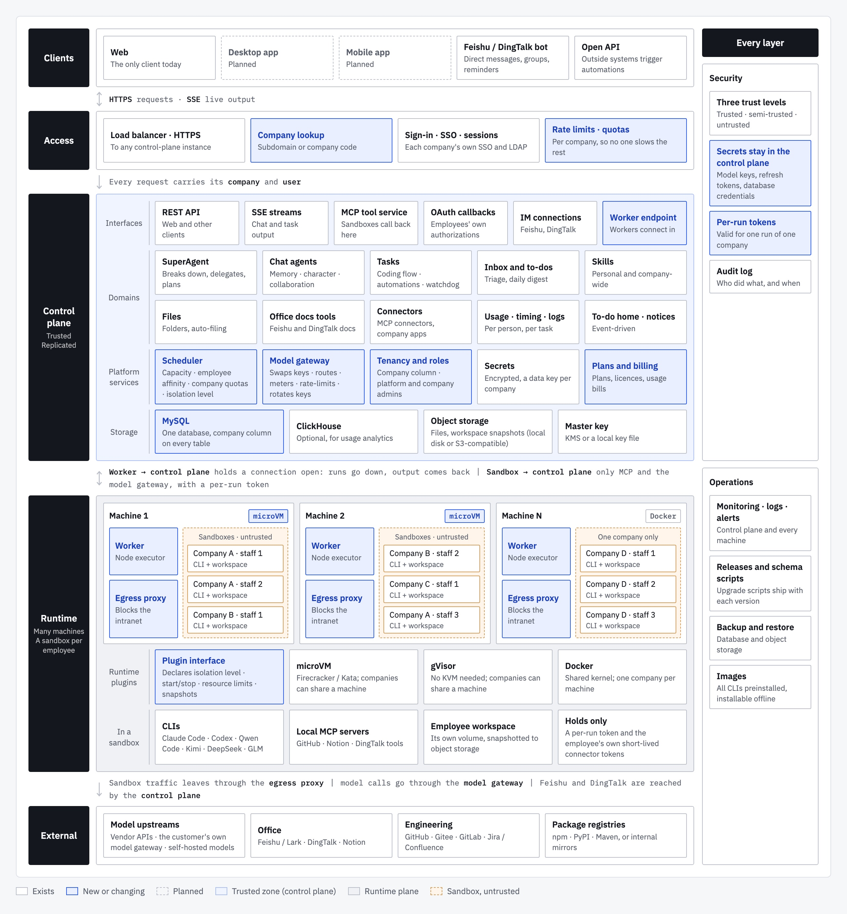

<p align="center">
  
</p>

**AI collaborative work system for companies, not personal assistants.** Everyone works with AI in one system, and the work becomes the company's assets. Open source and self-hosted.

[Website](https://oryx-labs.github.io/SuperAgent/) · [Live demo](http://117.72.92.117:18081/login) · [中文](https://oryx-labs.github.io/SuperAgent/zh/)

## Why SuperAgent

AI can do real work now. Models write code, documents and analyses, and official agents such as Claude Code and Codex carry a job through for tens of minutes on their own. Employees are already using them: they buy their own tokens, install agents on their own laptops, and get faster.

But all of it happens in personal places. The accounts, the spending and the results belong to each person; the company can't see what was done, can't build on it, and loses it when people leave. Everyone gets faster, and the company doesn't get any better at its work.

| Today | What SuperAgent does |
| --- | --- |
| Only people who tinker get AI working | Employees have AI from their first day; nothing to buy or set up |
| Results stay in personal accounts and leave with the person | Work happens in the company's system and becomes company assets |
| Nobody can pick up where someone else left off | Several people work with the same agent; agents and their context are handed over |
| Good methods stay with whoever found them | Methods become skills, personal first, then company-wide |
| Everyone pays separately and uses the most expensive model | One set of company keys; each task gets the cheapest model that can do it |
| The company can't see or control what AI does | Audit, analytics, control and governance; people decide at key points |
| Personal agents can't reach company systems | Feishu, DingTalk, Git and docs connected once, used with each person's own authorization |
| Long tasks break on a laptop and nobody notices | Tasks are assigned, scheduled, tracked and run to completion |

## What we believe

1. **Scattered AI use will be gathered up by companies.** Every technology that enters a company starts with individuals and ends with the company managing it. The lasting value is control, accumulation and cost.
2. **Leave the intelligence to the models and official agents.** A home-made agent loop can't keep up with official agents that are tuned together with their models. SuperAgent drives the official CLIs (Claude Code, Codex, Qwen Code, Kimi and more) instead of rebuilding them, so every improvement in models and agents becomes an improvement in SuperAgent.
3. **The value is at the company level.** Who owns the results, who can see them, how work is handed over, who does what, what it costs, which systems it touches: these span people, time and systems, and only a company-wide system can handle them.
4. **Stay neutral about model vendors.** Any vendor's models, a company's own model gateway and self-hosted models can all be used. Each task goes to the model that fits it best, which keeps cost down; the assets a company builds belong to the company, not to any model.
5. **Agents must follow the rules before companies let them work.** Agents run in isolation, touch only what they should, leave a record of what they did, and stop for people at the decisions that matter.
6. **The more complex the work, the more it needs a system to run it.** As tasks grow from minutes to hours and run every day, companies need something to assign, schedule, track and finish them reliably and cheaply.

## Core capabilities

In priority order.

1. **Work becomes company assets.** Everyone works in one system. What agents produce and what people send them (files and links) is filed automatically in Files, and each agent keeps its own long-term memory. When people change, the agents stay with their memory and files.
2. **Collaboration and handover.** Several people work with the same agent on the same job, and colleagues can be invited from the chat. Each person has a SuperAgent that breaks work down, hands it to agents or tasks, and follows up. When someone leaves, the next person picks up their agents and carries on.
3. **Reusable methods.** Skills at the personal and company levels turn one person's good practice into everyone's default.
4. **Model-neutral and cost-efficient.** Claude Code, Codex, DeepSeek, Kimi, Qwen and GLM run the work, on the company's keys, with failover across several keys. Each task picks the cheapest model that can do it and moves up a level when it fails. Every model call is recorded against a person, a task and a model.
5. **Audit, control and governance.** People approve plans and key decisions. Company-wide analytics and usage per person, per-agent run logs, permissions per person, and secrets encrypted at rest.

Also included:
- Tasks from requirement to delivery, with a coding flow (PRD, development, verification).
- Scheduled, one-off and API-triggered automations.
- Feishu / Lark and DingTalk messages triaged into a to-do home page.
- Connectors: GitHub, Gitee, Feishu / Lark docs, DingTalk docs and tools, Notion, Confluence, and your own MCP servers.
- An admin console for users, models and prices, analytics, integrations and file storage (on the server or S3-compatible).

## Where it's going

**Automated, intelligent, always on.** Today SuperAgent helps people and AI finish work together. As models get stronger, the software matures and each company's knowledge builds up, people need to step in less and less: first AI finishes the work and people confirm key points, then processes run on their own and people check the results, and finally the system runs around the clock while people set direction. Every file, memory and skill kept today is fuel for the automation of tomorrow.

## Architecture

SuperAgent has three layers. The **control plane** is the trusted part: the interface, all business logic, scheduling, the model gateway, data and secrets. **Workers**, one per machine, start sandboxes and relay their output. **Sandboxes**, one per employee, run the agent CLIs in isolation, holding no long-lived secrets. The runtime is pluggable (microVM, gVisor or Docker), and SaaS and on-premises deployments run the same code.

<p align="center">
  
</p>

This is the target architecture. Today's release runs the control plane and the agent CLIs on one server; the sandboxes, Workers and model gateway are being built.

## Documents

The thinking behind SuperAgent, in `docs/prd/` (HTML; open them in a browser):

- [Core judgments](docs/prd/superagent-core-thesis.html): why SuperAgent should exist, who it's for, and what it aims to become.
- [Product thinking](docs/prd/superagent-product-thinking.html): positioning, product principles, value and scenarios.
- [Technical architecture](docs/prd/superagent-architecture.html): layers, modules, key designs and data flows.
- Architecture diagrams: [English](docs/prd/architecture-diagram-en.html) · [中文](docs/prd/architecture-diagram-zh.html)

## Install

Every release on the [Releases page](https://github.com/oryx-labs/SuperAgent/releases) has a tarball (`superagent-<version>.tar.gz`, with its `.sha256`) and a Docker image.

**Docker** (the image has Java 21, Node.js 24 and the agent CLIs preinstalled: Claude Code, Codex, Gemini CLI, Qwen Code, Kimi Code and DeepSeek Harness):

```bash
cp docker/.env.example docker/.env      # set the admin and MySQL passwords
docker compose -f docker/docker-compose.yml --env-file docker/.env up -d
```

This starts SuperAgent with MySQL on `http://<host>:18080`. The image is `ghcr.io/oryx-labs/superagent:<version>` (or `:latest`). `ghcr.io/oryx-labs/superagent-base` is the same image without SuperAgent, if you only want the CLIs. If the host can't reach the model APIs directly, set `HTTPS_PROXY` in `docker/.env`.

**Tarball:** download it from the release, then follow [Configure](#configure) and [Start and stop](#start-and-stop) below.

## Build and run

### Requirements

- Java 21+ and Maven (to build); Java 21+ on the server (to run)
- MySQL 8 (the default storage; tables are created on first start)
- The agent CLIs on the server's `PATH`: [Claude Code](https://www.npmjs.com/package/@anthropic-ai/claude-code) and/or [Codex](https://www.npmjs.com/package/@openai/codex). These can also be installed later from the **Models** page.

### Package

From the repository root:

```bash
mvn clean package -PreleaseTgz              # add -DskipTests to skip the tests
```

This produces `superagent-server/target/superagent-<version>.tar.gz`, which unpacks to:

```text
superagent-<version>/
├── bin/      superagent-start.sh, superagent-stop.sh
├── config/   application.yml, superagent.env
├── libs/     superagent.jar
├── logs/     superagent.log, console.out, superagent.pid
└── data/     agent and task workspaces
```

### Configure

- `config/superagent.env`: secrets and deployment values, sourced by the start script. It includes the admin password, MySQL connection, `SERVER_PORT` and `JAVA_OPTS`. Outside systems (the GitHub OAuth app, the Feishu app) are set up by an administrator under **Admin → System Settings → Integrations**, not in this file. Every entry ships commented out. Keep the file at mode `600`.
- `config/application.yml`: overrides the defaults built into the jar. Changes take effect on restart, with no repackaging.

At minimum, set these before the first start:

```bash
SUPERAGENT_ADMIN_PASSWORD=<a strong password>
SUPERAGENT_STORAGE_MYSQL_URL=jdbc:mysql://127.0.0.1:3306/superagent
SUPERAGENT_STORAGE_MYSQL_USERNAME=superagent
SUPERAGENT_STORAGE_MYSQL_PASSWORD=<password>
```

### Start and stop

```bash
tar -xzf superagent-<version>.tar.gz
cd superagent-<version>

bin/superagent-start.sh          # start in the background
bin/superagent-start.sh force    # restart: stop the running process, then start
bin/superagent-stop.sh           # stop
```

- **Start:** checks for Java 21+, then reports success only once `/actuator/health` responds. If the server is already running, it refuses to start a second copy. If startup fails, it prints the end of the log.
- **force:** stops the running process with SIGTERM. The server shuts down gracefully; if it is still running after 35 seconds (`STOP_TIMEOUT`), it is killed. The server then starts again.
- **Working directory:** the scripts can be run from any directory. Relative paths in the config, such as `./data`, resolve against the install directory.

Once started, open `http://<host>:18080` and sign in as the admin user.

### Development

```bash
mvn clean install                                  # build and test all modules
mvn -pl superagent-server spring-boot:run          # run locally on :18080
```

Under `spring-boot:run`, the UI is served straight from `superagent-ui/src/main/resources/static`, so front-end edits show up on a browser refresh with no rebuild or restart. Back-end (Java) changes still need `mvn install` and a restart.

### Releasing

A pull request to `main` whose title starts with `release:` is a release. The version is the one in the pom, so bump it in that pull request:

```bash
mvn versions:set -DnewVersion=0.2.0 -DgenerateBackupPoms=false   # every module's pom
```

While the pull request is open, [the release workflow](.github/workflows/release.yml) builds, tests, packages and builds the image without publishing anything. When it's merged, the workflow tags `v<version>`, publishes the GitHub Release with the tarball and its checksum, and pushes the images to `ghcr.io` for `linux/amd64` and `linux/arm64`. A version that's already released fails the check, and release pull requests must come from a branch in this repository. Versions ending in `-alpha`, `-beta` or `-rc` are published as pre-releases, without moving `latest`.

## Status

SuperAgent is iterating fast. The core is already running in daily use; what isn't built yet is on the [roadmap](https://oryx-labs.github.io/SuperAgent/docs/roadmap).

## License

SuperAgent is licensed under the Apache License 2.0 with the Commons Clause. See [LICENSE](LICENSE).
