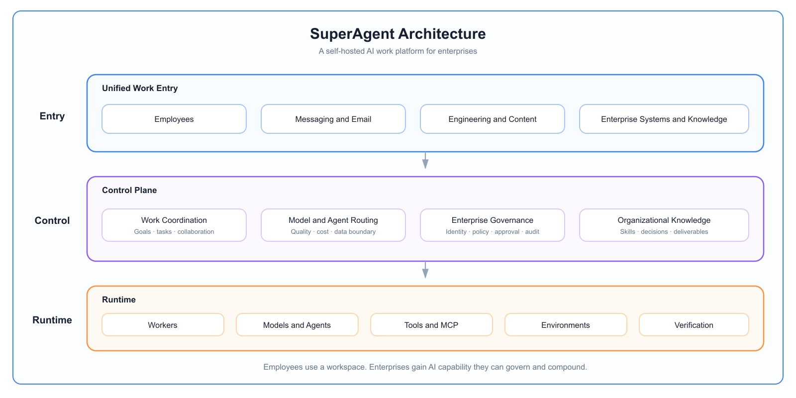

<p align="center">
  
</p>

**The AI work system for companies, not personal assistants.** Everyone in the company works in one system, and the work becomes the company's assets. Open source and self-hosted.

[Website](https://oryx-labs.github.io/SuperAgent/) · [Live demo](http://117.72.92.117:18081/login) · [中文](https://oryx-labs.github.io/SuperAgent/zh/)

## What is SuperAgent?

Most AI agents today are personal assistants. They make one person faster, keep the work in that person's account, and leave with them.

SuperAgent is designed from the company's side instead: the company and its employees. Companies need AI that actually gets used. It has to be useful, affordable, and able to do any kind of work. SuperAgent is a system the company deploys once for everyone. Employees get AI from their first day, everyone works in the same place, and that work automatically becomes company assets that don't disappear when people change.

| | Personal AI assistants | SuperAgent |
| --- | --- | --- |
| Who it serves | One person | The whole company and its employees |
| Where the work goes | A personal account; leaves with the person | Company assets that accumulate automatically |
| Working together | Everyone separately | Shared agents, and handoff when people leave |
| Cost | Every employee subscribes; tokens wasted | Ready on day one, billed by usage, routed to the right model |
| Control | Invisible to the company | Company-controlled, audited, connected to approvals |

## Why SuperAgent?

Handing every employee a personal assistant doesn't make AI work for a company. The work leaves with the person, colleagues can't build on each other, knowledge never accumulates, costs are scattered and wasteful, and the company can't see any of it.

**In short, SuperAgent is company-controlled, cost-efficient, accumulates assets automatically, and is easy to use.**

## Core capabilities

In priority order. Items marked *(coming soon)* are still being built.

1. **Work becomes company assets.** Everyone works in one system, so conversations, tasks, and deliverables stay with the company. Agents distill what they learn into memory, and the system summarizes and consolidates work into company knowledge *(company-wide consolidation: coming soon)*.
2. **Collaboration and handoff.** Collaboration happens inside one AI system: several people can work with the same agent on the same job. When someone leaves, their agents and context go to the next person, who continues from there *(handoff: coming soon)*.
3. **Assets for each person, team, and the company.** Knowledge bases at the employee, team, and company levels, plus personal and company skills, hold what everyday work needs, so a new hire starts with what the team already knows.
4. **Cost and models.** Employees get AI on day one, with no personal subscriptions and no wasted tokens. The company pays by usage, sees spend per task and per model, works with any model provider, and routes each task to a model that fits its difficulty *(routing by difficulty: coming soon)*.
5. **Audit and security.** Built-in audit and security: human confirmation for key decisions, identity and permissions, per-agent run logs, and office tools such as Feishu, with enterprise approvals connected *(approvals: coming soon)*.

Also included: a SuperAgent for every employee (inbox, plan-then-execute, team assignment, reporting back), task execution in managed sessions including coding agents such as Claude Code and Codex, and scheduled, one-off, and API-triggered automations.

## Architecture

<p align="center">
  
</p>

## Build and run

### Requirements

- Java 21+ and Maven (to build); Java 21+ on the server (to run)
- MySQL 8 (the default storage; tables are created on first start)
- The agent CLIs on the server's `PATH`: [Claude Code](https://www.npmjs.com/package/@anthropic-ai/claude-code) and/or [Codex](https://www.npmjs.com/package/@openai/codex). These can also be installed later from the **Models** page.

### Package

From the repository root:

```bash
mvn clean package -PreleaseTgz              # add -DskipTests to skip the tests
```

This produces `superagent-server/target/superagent-<version>.tar.gz`, which unpacks to:

```text
superagent-<version>/
├── bin/      superagent-start.sh, superagent-stop.sh
├── config/   application.yml, superagent.env
├── libs/     superagent.jar
├── logs/     superagent.log, console.out, superagent.pid
└── data/     agent and task workspaces
```

### Configure

- `config/superagent.env`: secrets and deployment values, sourced by the start script. It includes the admin password, MySQL connection, GitHub OAuth, `SERVER_PORT` and `JAVA_OPTS`. Every entry ships commented out. Keep the file at mode `600`.
- `config/application.yml`: overrides the defaults built into the jar. Changes take effect on restart, with no repackaging.

At minimum, set these before the first start:

```bash
SUPERAGENT_ADMIN_PASSWORD=<a strong password>
SUPERAGENT_STORAGE_MYSQL_URL=jdbc:mysql://127.0.0.1:3306/superagent
SUPERAGENT_STORAGE_MYSQL_USERNAME=superagent
SUPERAGENT_STORAGE_MYSQL_PASSWORD=<password>
```

### Start and stop

```bash
tar -xzf superagent-<version>.tar.gz
cd superagent-<version>

bin/superagent-start.sh          # start in the background
bin/superagent-start.sh force    # restart: stop the running process, then start
bin/superagent-stop.sh           # stop
```

- **Start:** checks for Java 21+, then reports success only once `/actuator/health` responds. If the server is already running, it refuses to start a second copy. If startup fails, it prints the end of the log.
- **force:** stops the running process with SIGTERM. The server shuts down gracefully; if it is still running after 35 seconds (`STOP_TIMEOUT`), it is killed. The server then starts again.
- **Working directory:** the scripts can be run from any directory. Relative paths in the config, such as `./data`, resolve against the install directory.

Once started, open `http://<host>:18080` and sign in as the admin user.

### Development

```bash
mvn clean install                                  # build and test all modules
mvn -pl superagent-server spring-boot:run          # run locally on :18080
```

Under `spring-boot:run`, the UI is served straight from `superagent-ui/src/main/resources/static`, so front-end edits show up on a browser refresh with no rebuild or restart. Back-end (Java) changes still need `mvn install` and a restart.

## Status

SuperAgent is iterating fast. The core is already running in daily use; items marked *coming soon* above are still being built.
