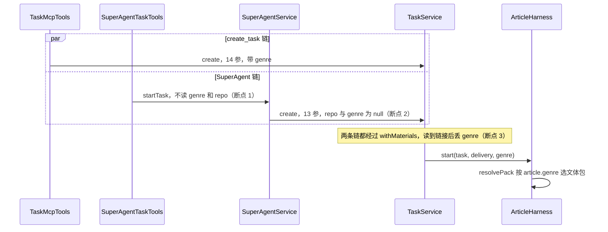
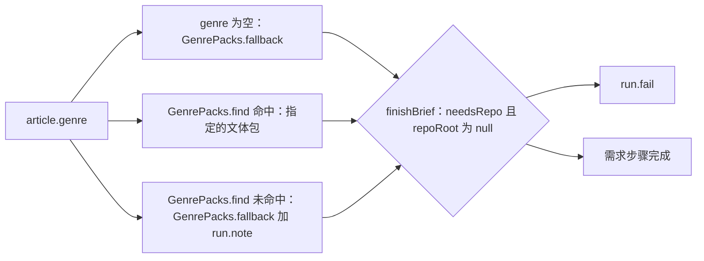

# 让 assign_task 和 start_task 能指定写作文体（genre）的方案

给 assign_task 和 start_task 各加选填的 `genre` 和 `repo`。genre 用 `TaskKinds.genre` 解析，`SuperAgentService.dispatch` 用 14 参的 `CreateTaskRequest` 传给 `TaskService.create`。repo 只在 kind=article 时生效，后台轮次的 assign_task 不收 repo。

`TaskService.withMaterials` 会丢掉 genre（`superagent-task/src/main/java/com/superagent/task/TaskService.java:762-764`，[E17]），这个修复单独提交、先合入。`SuperAgentTools` 新增 `article_genres`。文体名不存在时沿用 create_task 的处理：运行时退回「通用长文」并记一条 note [E21]。

## 背景

SuperAgent 派出的写作任务，现在全部按「通用长文」执行。

两个派活工具的 kind 说明都写着「文体用 genre 参数指定……不填按通用长文」（`superagent-task/src/main/java/com/superagent/task/TaskKinds.java:16-25`，[E4]）。

可是两个工具的 schema 都没有 genre 字段 [E6][E10]。生产代码里 6 处构造 `CreateTaskRequest` [E34][E58]，只有 create_task 那 1 处传了 genre（`superagent-task/src/main/java/com/superagent/task/TaskMcpTools.java:87-93`，[E2][E35]），其余 5 处用 9 到 13 参的构造器，都没有 genre [E13][E17][E59][E60][E61]。

repo 也要一起补。SuperAgent 的确认表要求「技术调研、技术方案要读仓库，所以「代码位置」必填」（`superagent-agent/src/main/java/com/superagent/agent/chat/TaskConfirmPrompt.java:92`，[E30]），但 start_task 收不到这个值 [E10]。

## 目标和非目标

目标：

- assign_task 或 start_task 传 `genre=技术方案` 后，`harness().article().genre()` 返回「技术方案」，和现有 create_task 测试同一口径（`superagent-task/src/test/java/com/superagent/task/TaskServiceTest.java:1010-1012`，[E33]）。
- 不传 genre 时该值为 null（同文件第 1008 行，[E33]），运行时落到「通用长文」[E21]。
- 文体名不存在时，任务照常建成，运行时回退并留 note [E21]。
- brief 带链接时 genre 不丢。

非目标：不在建任务时校验 genre [E3]；不改表 [E14]；不改 `resolvePack`；不给 `ArticleHarness` 加 precheck [E40]；不让 SuperAgent 建编码任务；不改 `propose_plan` 和 `SuperAgentPrompts`，后台轮次的 genre 只靠字段说明和 `article_genres` 决定。

## 现状

在 create_task 这条链上，genre 是原样往下传的字符串；SuperAgent 这条链有三个断点，见图 1。

create_task 用 `TaskKinds.genre(args)` 取值，作为 14 参构造器的最后一个参数 [E1][E2]。`TaskService.create` 把它交给 `harness.start`（`superagent-task/src/main/java/com/superagent/task/TaskService.java:854`，[E18]），`ArticleHarness.start` 写进 `article.genre` [E20]，运行时由 `resolvePack` 选文体包 [E21]。

断点 1：两个工具的 handler 都不读 genre 和 repo，调用的是 7 参的 `assign` 和 `startTask` [E7][E11]。

断点 2：`dispatch` 用 13 参构造器，repo 写死为 null（`superagent-orchestrator/src/main/java/com/superagent/orchestrator/SuperAgentService.java:723-739`，[E13]）。内置「技术方案」包配置了 `needs_repo: true` [E24]，`finishBrief` 遇到需要仓库而 `repoRoot` 为 null 时会 `run.fail` [E22]。所以只补 genre、不补 repo 时，技术方案任务会在需求步骤失败。

断点 3：`withMaterials` 读到链接后用 13 参构造器重建请求，丢掉 genre [E17]。触发条件：brief 里有能被 `LinkUrls` 匹配的链接 [E38][E16]，且 `linkReader` 已注入（`@Autowired(required = false)`，[E36]；实现是 `LinkReaderService`，[E37]）。dispatch 走的 5 参 `create` 也经过这里 [E15]。线上是否注入，只能按 `superagent-server/pom.xml:55-59` 对 superagent-docs 的依赖推断 [E49]，未验证。

还有两处次要缺口：

- `TaskMcpTools.kinds()` 只返回 `Kind.CHAT` [E27]，SuperAgent 的工具白名单里也没有它的工具 [E28]，所以 SuperAgent 调不到 `article_genres`。
- 确认表的「文体」一行由 `article("create_task".equals(tool))` 控制 [E29]，SuperAgent 传的是 `"start_task"` [E30]。


图 1　两条建任务链路，断点 3 两条链都会经过

## 方案

按改动表计，改 5 个生产类、3 个测试类，不动数据模型。提交 1 先单独合入，提交 2 和 3 同一次发布上线（原因见风险表第 4 行）。

| 提交 | 类 | 方法或位置 | 改动 |
|---|---|---|---|
| 1 | `TaskService` | `withMaterials` | 重建请求时带上 `request.genre()` |
| 2 | `SuperAgentTools` | `list()`、`run()` 的 assign_task | schema 加 `genre`、`repo`；后台轮次不传 repo |
| 2 | `SuperAgentTaskTools` | `tools()`、`call()` | schema 加 `genre`、`repo`，传给 `startTask` |
| 2 | `SuperAgentService` | `assign`、`startTask`、`dispatch`；新增静态方法 `articleRepo` | 加两个参数，非 article 丢掉 repo，改用 14 参构造器 |
| 3 | `SuperAgentTools` | `NAMES`、构造器、`list()`、`run()` | 新增 `article_genres`，注入 `GenrePacks` |
| 3 | `TaskConfirmPrompt` | `rules` 中 `article(...)` 的条件 | `start_task` 也加「文体」一行 |

### 数据模型

不改。`CreateTaskRequest` 已有 `genre` 字段（`superagent-api/src/main/java/com/superagent/api/task/CreateTaskRequest.java:29-31`，[E14]）。

### 接口：工具 schema

两个工具各加两个选填字段，required 名单不变；`req` 和 `opt` 生成的字段一样，是否必填只看名单 [E42]。

- `genre`：说明用 `TaskKinds.GENRE_DESCRIPTION` [E3]。
- `repo`：说明为新增，「写作任务的文体要读代码仓库时（如技术方案），填这台服务器上的本地仓库路径；其他任务类型填了也会被忽略」。assign_task 再加一句「后台处理时不收」。

assign_task 用 `SuperAgentTools` 私有的 `field(...)` 声明 [E43]，start_task 用 `opt(...)` [E10]。

### handler

```java
// SuperAgentTools.run，"assign_task" 分支：后台轮次不收 repo
String repo = service.isBackground(grant) ? null : text(args, "repo");
service.assign(owner, required(args, "member_id"), text(args, "title"), text(args, "brief"),
        grant.messageId(), TaskKinds.require(args), repo, TaskKinds.genre(args), TaskWaits.parse(args));

// SuperAgentTaskTools.call（只在聊天里可用）
superAgent.startTask(user, strOrNull(args, "member_id"), require(args, "title"), require(args, "brief"),
        grant.messageId(), TaskKinds.require(args), strOrNull(args, "repo"), TaskKinds.genre(args),
        TaskWaits.parse(args));
```

`isBackground` 判断的是 `backgroundGrants.containsKey(grant.token())`（`superagent-orchestrator/src/main/java/com/superagent/orchestrator/SuperAgentService.java:845-847`）。orchestrator 已依赖 superagent-task，可直接调用 `TaskKinds` [E31]。

### 服务层

两个 7 参重载和 `dispatch` 都改成 9 参，在 `kind` 后面加 `String repo, String genre`，`after` 仍在最后。4 参便捷重载补两个 null。`assign` 里的 `requireApproved(owner)` 不变 [E12]。`dispatch` 改为：

```java
String articleRepo = articleRepo(kind, repo); // 新增包内静态方法：kind=article 时返回 repo，否则 null
new CreateTaskRequest(title.strip(), fullBrief, "web_chat", articleRepo, null, null,
        model, providers.cliFor(model).orElse(null), kind, null, null, null, after, genre)
```

repo 只放给 article，依据是 `TaskKinds` 类注释「coding runs three gated steps and costs far more」（`superagent-task/src/main/java/com/superagent/task/TaskKinds.java:9-12`，[E62]）。kind=coding 时 repo 仍为 null，照旧被 `CodingHarness.precheck` 拒绝 [E41]。

### TaskService

`withMaterials` 末尾的构造调用补上 `request.genre()`，改用 14 参构造器 [E17]。

### article_genres 和确认表

`article_genres` 放进 `SuperAgentTools`，因为 `NAMES` 同时进入后台和聊天两个白名单 [E28]，后台调 assign_task 前也能先查。`SuperAgentTaskTools.call` 会拒绝后台调用和 start_task 以外的工具名 [E53]，放不进去。这个工具只读，不在 `ACTING_TOOLS` 里 [E45]。

1. `NAMES` 加 `"article_genres"`，`run()` 返回 `genres.describe()`，格式照 `TaskMcpTools` 的同名工具 [E27]。
2. 新增 `@Autowired` 的 3 参构造器注入 `GenrePacks`，2 参构造器保留并转调 `GenrePacks.none()`，写法同 `TaskMcpTools` [E57]。测试里的 `new SuperAgentTools(service, null)` 不用改 [E54]。
3. `TaskConfirmPrompt.rules` 的条件改成 `article("create_task".equals(tool) || "start_task".equals(tool))` [E29]。

同名工具不冲突：`McpController` 按 `p.kinds().contains(grant.kind())` 过滤 provider [E48]，`TaskMcpTools` 只声明了 `Kind.CHAT` [E27]。

### 流程

genre 进入 `ArticleHarness` 后，`resolvePack` 三路选包，然后都经过 `finishBrief` 的缺仓库检查，见图 2。这部分代码不改。


图 2　resolvePack 三路选包，都汇到 finishBrief 的缺仓库检查

`resolvePack` 在 `superagent-task/src/main/java/com/superagent/task/harness/article/ArticleHarness.java:223-241` [E21]。`GenrePacks.fallback` 就是 `find("通用长文")`；`GenrePacks.find` 先按 skill 名、再按 genre id 比较，都转小写 [E26]。照代码推断「技术方案」和 `tech-design` 都能命中 [E24]，未跑测试验证。`finishBrief` 的检查在第 260 行，对三路都生效 [E22]；内置通用长文包是 `needs_repo: false` [E24][E25]，所以回退到内置通用长文不会因缺仓库失败。

## 备选方案

**备选 A：建任务时校验 genre**，`GenrePacks.find` 不命中就报错。

- 优点：模型能当场改正。
- 放弃原因：create_task 只在运行时回退 [E3][E21]，要一致就得连它一起改，超出范围。`find` 内部的 `load` 还可能抛 `GenrePackException` [E50]，它继承 `IllegalArgumentException` [E51]，建任务时要多处理一种异常。

**备选 B：把文体写进 brief。**

- 优点：方法签名和 `SuperAgentDelegatesTest` 第 62 行的桩都不用改 [E32]。
- 放弃原因：建任务时只有 `ArticleHarness.start` 写 `article.genre` [E20]；brief 里的文体要等需求步骤的 `switchPack` 从作者回复里读出并命中，才改写它 [E52]。repo 的问题也没解决 [E13]。

## 迁移和兼容

不涉及存量数据，旧调用行为不变。

- **存量任务**：genre 只在建任务时随 `harness.start` 写入 phaseStore [E18]。
- **旧调用**：不传新字段时，14 参构造器拿到两个 null；原 13 参构造器本来就是把 genre 补成 null [E14]。
- **kind 判定**：kind 非空时 `resolveKind` 直接用它 [E19]。
- **编码任务**：仍被 precheck 拒绝 [E41]，以工具错误返回 [E8][E11]。
- **回滚**：各提交可分别 revert，提交 1 建议保留。

## 风险和应对

| 风险 | 触发条件 | 影响 | 应对 |
|---|---|---|---|
| 后台轮次替写作任务指定仓库 | 后台调 assign_task 带了 repo | 用户确认计划时看不到 repo（计划任务项只有 title、assignee、brief，`superagent-orchestrator/src/main/java/com/superagent/orchestrator/SuperAgentTools.java:89-92`） | 后台轮次丢掉 repo；外部消息轮次拿不到 assign_task [E45][E46]，`requireOwnInput` 再拦一次 [E47] |
| 后台派的技术方案任务缺仓库 | 后台派 genre=技术方案的任务 | 需求步骤 `run.fail` [E22] | 上一条的代价，见待定问题 2 |
| 需要仓库的文体没给 repo | 聊天里 repo 为空或不在允许目录 [E23] | 需求步骤 `run.fail` [E22] | repo 的字段说明写清楚 |
| 提交 2 上线、提交 3 未上线 | genre 说明要求「先用 article_genres 看公司有哪些」（`superagent-task/src/main/java/com/superagent/task/TaskKinds.java:29`，[E3]），SuperAgent 却调不到 | 模型调不存在的工具或凭猜测填 | 提交 2、3 同一次发布 |
| 文体名拼错 | genre 和所有包都对不上 | 静默回退，只留 note [E21] | 聊天和后台都能调 `article_genres` [E28]；确认表加「文体」行 |

## 测试和验收

每条验收对应一个单元测试，`mvn -pl superagent-orchestrator,superagent-task,superagent-agent -am test` 全部通过即达标（命令未跑过）。

1. **start_task 透传**：`superagent-orchestrator/src/test/java/com/superagent/orchestrator/SuperAgentDelegatesTest.java:62` 的 7 参桩改成 9 参 [E32]；新增用例传 `"genre":" 技术方案 "`、`"repo":"/srv/repo"`，verify 收到 `"/srv/repo"` 和 `"技术方案"`。
2. **assign_task 透传、后台不收 repo**（新增）：照同文件第 79-82 行构造 `SuperAgentTools` 和 chat grant [E54]；再把 `isBackground` 桩成 true，verify repo 为 null。
3. **articleRepo**（新增）：`SuperAgentService` 构造器有 20 个参数（`superagent-orchestrator/src/main/java/com/superagent/orchestrator/SuperAgentService.java:206-215`），直接测静态方法：general、coding 返回 null，article 返回 `"/srv/repo"`。
4. **带链接不丢 genre**（新增）：先照 `superagent-task/src/test/java/com/superagent/task/TaskServiceTest.java:996-999` 设 `setHarnesses` 和 `useScheduler` [E33]，再照第 290-295 行用 `useLinkReader` 注入假 reader [E39]；brief 带链接，断言 genre 仍是「技术方案」。改动前会失败 [E17]。
5. **不传 genre**：沿用 `TaskServiceTest` 第 1008 行的断言 [E33]。
6. **确认表**：`superagent-agent/src/test/java/com/superagent/agent/chat/TaskConfirmPromptTest.java:30` 改成断言 start_task 的确认表包含「| 文体 |」和「article_genres」[E56]。
7. **白名单**：照 `SuperAgentDelegatesTest` 第 13、22-23 行 [E55]，断言 `BACKGROUND_TOOLS` 和 `CHAT_TOOLS` 都含 `"mcp__superagent__article_genres"`。

## 待定问题

1. **断点 3 影响了哪些任务、要不要通知用户。** 线上 `linkReader` 是否注入未验证 [E36][E37][E49]。选项：查出并告知，或不处理。值班后端工程师在提交 1 上线前定，不影响提交 1 合入。
2. **后台派出的技术方案任务怎么拿到仓库。** 选项：需要仓库的写作任务只在聊天里用 start_task 派；或给 `propose_plan` 的任务项加 repo，让用户确认计划时看到。SuperAgent 产品负责人在有成员要接技术方案类任务前定。
3. **其他构造点要不要支持 genre。** `UserInboxService`、`AutomationService` 的 kind 都传 null [E59][E60]，这次不改。SuperAgent 产品负责人在提出自动化写作需求时定。
