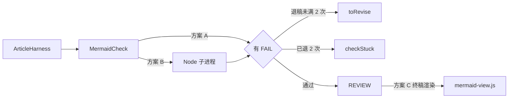

# 写作 harness 的 Mermaid 校验要不要换成官方 parser：在 MermaidCheck、Node 子进程和前端报错三者之间做选择

## 问题和决策点

结论：现在先不整体换。下一步只做两件事，都不改生产路径：一是用测试用例复现 `MermaidCheck` 里推断出的误报，复现了再修；二是做一次 Node 子进程 parse 的小实验，用结果决定语法这一项要不要交给官方 parser。

写作 harness 每一轮平台检查都会调用 `MermaidCheck.check` [E15]。内置文体包的 `checks:` 配置有 4 处，其中 2 处开了 `mermaid` [E18]。按类注释，`MermaidCheck` 是「a light structural check in Java, not Mermaid's own parser」[E1]。

有一项 FAIL，稿件就退回修改 [E16]。退稿次数 `fixRounds` 小于 `RETURNS = 2` 时退稿，到 2 时任务进入 `checkStuck` 等用户处理（`superagent-task/src/main/java/com/superagent/task/harness/article/ArticleHarness.java:558-565`）[E17]。检查通过时，`fixRounds` 清零（`superagent-task/src/main/java/com/superagent/task/harness/article/ArticleHarness.java:555`）。

这次要决定的是：图的语法校验用哪种方式做。

- A：保持 Java 轻量校验；
- B：用 Node 子进程调用官方 mermaid parser；
- C：后端不查，只靠前端渲染时报错。

这次不讨论的事：要不要换掉 Mermaid；编号、引用、节点数这几条规则本身；检查阈值怎么校准。

## 评估维度及权重

进入加权比较之前，先设一道门槛：语法错误必须能在 harness 里触发退稿。

这里和提纲有两处不同，理由如下。第一，提纲里的百分比改成了排序。五个维度里，速度三格都是「未验证」，误报只有推断没有频率，拿百分比去乘这些格子，算出来的分数是假精确，所以只排先后。第二，加了门槛这一行。C 的部署和维护成本都是零，如果直接参与加权，可能凭这两项拿分；但它根本不会让作者在交稿前改图，这是有或没有的问题，不该拿分数去抵。

| 维度 | 权重 | 为什么重要（对我们） |
|---|---|---|
| 门槛：能触发退稿 | 必须满足 | 退稿是 harness 让作者改图的方式 [E16] |
| 误报风险 | 最高 | 合法的图被判 FAIL 会占掉一轮退稿；退满 2 次后任务卡在 `checkStuck` 等人处理 [E16][E17] |
| 能抓出的错误种类 | 次高 | 漏掉的错误会带进终稿，读者看到的是源码加一行提示 [E25] |
| 部署要求 | 中 | 关系到 Java 服务旁边要不要有 Node，以及 parser 文件从哪里来 |
| 维护成本 | 较低 | 规则要跟着 Mermaid 版本走 |
| 速度 | 最低 | 本次不运行代码，三个方案都没计时 |

`superagent-task/src/main/java/com/superagent/task/harness/article/TechChecks.java:25-29` 的类注释写的是「Pure functions of the draft」[E31]。B 要起外部进程，会打破这个前提，代价记在部署和维护两项里。

## 候选方案

三个方案的区别在于：语法错误在哪一层被发现，发现之后会不会退稿。见图 1。A 和 B 都在 `MermaidCheck` 判 FAIL，之后走 `toRevise`，退满 2 次进入 `checkStuck`。C 要等稿子过了 `REVIEW`、在 `mermaid-view.js` 渲染终稿时才发现问题。

图 1　A、B、C 三处检查点和退稿路径

### 方案 A：Java 轻量校验（MermaidCheck，现状）

A 是 330 行 Java，import 只有 JDK 的 `java.util` 和 `java.util.regex`，没有第三方依赖 [E3]。检查分三层：

- 图类型：首行要在 `TYPE` 白名单里，不在就 FAIL [E4]。
- 逐行语法：只有 flowchart、sequenceDiagram、erDiagram、stateDiagram 四类逐行检查 [E5][E6][E8][E9]，其余类型只看内容是不是空的。
- 规则：编号标题、正文引用、节点数不超过 15、名字和正文一致 [E2][E10]。

后两项规则的输入来自逐行解析。节点数用的是 `d.nodes()`，命名检查用的是 `d.labels()`，两者都由 `flow`、`sequence`、`er`、`state` 四个方法填充（`superagent-task/src/main/java/com/superagent/task/harness/article/MermaidCheck.java:149-155`、`superagent-task/src/main/java/com/superagent/task/harness/article/MermaidCheck.java:67-84`）。其他类型的图 nodes 恒为 0，所以节点上限对 classDiagram、gantt 等实际不起作用。编号和引用只看正文，不依赖解析器。

适用：稿子里的图基本只用这四类，写法也常规。
不适用：用了白名单外的类型，或者正则没覆盖的写法。

### 方案 B：Node 子进程调用官方 parser

B 只能接手语法这一项。编号和引用照旧在 Java 里做 [E10]，节点数和命名还需要逐行解析的结果。所以要么保留 A 的四个解析方法，要么让 Node 那边把节点和标签也传回来。

parse 入口目前只有间接证据：打包文件里能 grep 到 `async parse(` 和 `suppressErrors` 字样 [E23]。它是不是对外暴露的 `mermaid.parse`、出错时怎么返回，都未验证。

Node 有现成的来源：

- `docker/Dockerfile` 里写的基础镜像是 Node 24（据 E27 的 grep 输出；没有构建镜像核对）[E27]；
- 平台有私有 Node，可以通过 `superagent-web/src/main/java/com/superagent/web/provider/ProviderController.java:53-57` 的接口手动安装 [E35]，系统 npm 没有写权限时也会自动安装 [E28][E33][E34]；
- superagent-task 里已有起子进程的先例 [E29]：`superagent-task/src/main/java/com/superagent/task/harness/coding/Git.java:62` 和 `superagent-task/src/main/java/com/superagent/task/harness/article/ReadOnlyCommands.java:188`。

障碍有三条：

- parser 文件拿不到。`mermaid.min.js` 是 superagent-ui 的 classpath 静态资源，superagent-server 依赖 superagent-ui（`superagent-server/pom.xml:40`）。superagent-task 的 pom 里直接列出的 superagent-* 依赖是 skills、files、platform、glossary 四个，没有 superagent-ui（`superagent-task/pom.xml:22-37`），传递依赖没有核对。Node 子进程读的是磁盘上的文件，所以得先把它从 classpath 解出来写到磁盘，或者另外分发一份。
- 文件里有不少 `document.`、`window.` 引用 [E24]，推断是浏览器构建。在 Node 里能不能直接 parse，未验证。
- 本次在工作区里没找到 mermaid 的 npm 依赖，范围只限工作区 [E32]。

适用：实验证明 Node 无 DOM 也能 parse。
不适用：机器上没有 Node。

### 方案 C：只靠前端渲染报错

C 过不了门槛。渲染失败时，`superagent-ui/src/main/resources/static/js/mermaid-view.js:58-63` 只往页面插一行提示，30-63 行里没看到网络请求 [E25][E37]。

就算给 `mermaidFailed` 加上上报，也过不了门槛：渲染只在终稿或预览时发生，那时稿子已经过了 `REVIEW`，上报只能当数据或告警用，触发不了退稿。

本次在 `static/` 下 grep `renderMermaidBlocks`，只看到两处调用：`superagent-ui/src/main/resources/static/js/files.js:231` 和 `superagent-ui/src/main/resources/static/js/task-article.js:93` [E26]。这是只读 grep 的结果，动态调用没有覆盖。

## 对比

C 没过门槛，下表只比较 A 和 B，C 那一列只作对照。B 失败时要回退到 A，节点数和命名也还依赖 A 的解析，所以 B 的实际形态是「A 加上 Node」。

| 维度 | 方案 A：MermaidCheck | 方案 B：Node 子进程 parser | 方案 C：前端报错（未过门槛） |
|---|---|---|---|
| 误报风险 | 推断有多处，未运行验证 [E4][E7][E22] | 未验证 [E23][E24] | 不退稿，没有退稿误报 [E25] |
| 能抓出的错误种类 | 4 类图逐行查，6 种语法错误有测试 [E5][E12] | 未验证，取决于打包 parse 的覆盖范围 [E23] | 只在页面显示 [E25][E26] |
| 部署要求 | 零第三方依赖 [E3] | 要有 Node [E27][E34][E35]，还要把 `mermaid.min.js` 解到磁盘 | 无新增 [E26] |
| 维护成本 | 手写的语法子集随 Mermaid 升级不断变大 [E4][E22] | A 的全部成本，加上进程管理、超时处理、资源解包，再加上对齐 3,572,296 字节 vendor 文件的版本 [E20] | 无新增代码 [E25] |
| 速度 | 未验证 | 未验证（冷启动要加载 3,572,296 字节的文件 [E20]） | 未验证 |

A 的误报都是读正则推断出来的，没有运行验证，下面分条列出：

- 图类型白名单太窄。用 `grep -oE '\^\\s\*[A-Za-z0-9-]+'` 扫 vendor 文件，能看到的类型识别正则里，至少有 20 个首词不在 `TYPE` 白名单里，比如 `C4Context`、`xychart`、`sankey`、`block`、`packet`、`kanban`、`architecture`、`radar-beta`、`treemap`、`flowchart-elk`、`classDiagram-v2` [E4][E22]。这些首词是不是 11.17.0 实际支持的写法，未验证。
- `{{..}}`、`@{..}` 和 `A:::cls` 写法，按正则推断可能报「无法识别」[E7]。
- `A -- 文字 --> B`：文字是中文或多个词时，可能报错；是单个英文词时，可能多算一个节点 [E7]。`-->|文字|` 写法会被 `superagent-task/src/main/java/com/superagent/task/harness/article/MermaidCheck.java:199` 剥掉，不受影响。
- 体育场形 `A([..])`：评审认为会报错，我对照 `FLOW_NODE` 的 `\(\(?"?([^)"]*)"?\)?\)` 推断它应能匹配。两种判断都没运行过，放进实验 1 复现 [E7]。
- 节点上限只对四类图生效：其他类型的图 nodes 恒为 0，classDiagram、gantt 等即使超过 15 个节点也不会 FAIL（`superagent-task/src/main/java/com/superagent/task/harness/article/MermaidCheck.java:149-155`）。这是漏报，不是误报，同样放进实验 1。
- 合法输入的测试只覆盖 4 类图 [E13]。

权重最高的是误报一项，A 的误报可以就地修。B 不会让 A 的维护成本消失，因为回退路径和节点、标签的提取都还要靠 A。只有 B 能抓更多种类的错误时，这笔多出来的成本才算值；而这一点要等 Node 实验做完才知道 [E24]。

## 验证

本次只做了只读的量取，没有运行任何代码。所以上面列的误报都只是推断，速度也没有数据。

已经做了这些：

- `wc -l` 量行数 [E3]；
- grep 测试文件：10 个测试里有 4 个测 Mermaid [E11]；
- `wc -c` 量 `mermaid.min.js`：3,572,296 字节 [E19][E20]；
- grep 打包文件里的版本字符串、类型关键词、parse 和 DOM 引用 [E21][E22][E23][E24]。版本字符串 `"11.17.0"` 能 grep 到，但没找到版本声明在哪里 [E21]。

提交历史本轮没有复核 [E30]，不作为依据。

还没做的实验，按这个顺序做：

1. **修 A 之前必须先做**：把上一节列的写法写成 `TechChecksTest` 用例，跑一遍。清单是：白名单外的类型首词、`{{..}}`、`@{..}`、`A:::cls`、`A([..])`、`A -- 文字 --> B`（中文和单个英文词各一条），再加一张超过 15 个节点的 classDiagram。复现了的才修，没复现的不动。
2. Node 可行性：用 Node 加载 `mermaid.min.js` 并调用 `parse`。不加任何 DOM 补丁就能正确判定合法和非法用例，算通过。如果必须加 jsdom 之类的补丁，算有条件通过，补丁的维护量要记进 B 的维护成本，再重新比较一次。
3. 耗时：分别量冷启动和常驻进程两种方式下每张图的 parse 耗时，用 `MermaidCheck.check` 作对照。可接受的上限由后端负责人定，本文不预设数值。
4. 稿件语料：统计每篇稿子有几张图、用了哪些类型。手上没有语料，没做。

这些实验要改 `MermaidCheck.java`、`TechChecksTest.java`，还要执行 Node，超出了本次只读的约束。开工前要请负责人授权，并定好用系统 Node 还是私有 Node。

## 结论和推荐

推荐 A。顺序是：先做实验 1，复现了的误报就地修；实验 2、3 并行做，但只是实验，不改生产代码。C 过不了退稿门槛，不选。

这个推荐成立有三个前提：

- B 不会省掉 A。编号和引用在 Java 里，节点数和命名依赖 A 的逐行解析，B 失败时也要回退到 A [E10]；
- B 在 Node 下能不能跑、耗时多少，都未验证 [E23][E24]；
- B 还要多做一件部署工作：把 `mermaid.min.js` 从 superagent-ui 的 classpath 解到磁盘。

前提变了怎么办：

- 实验 2 通过，实验 3 的耗时也被接受：语法判定改调 B，A 的四个解析方法保留，只负责提取节点和标签；或者让 Node 那边把节点和标签一起传回来，再让这四个方法退役。找不到 Node 时回退到 A 的语法判定。
- 实验 2 不通过：继续用 A。白名单以 Node 实验或官方文档确认过的类型为准，在那之前只补实验 1 复现出来的类型。
- 稿子里白名单外的图类型越来越多：A 的维护成本那一格会越来越大，B 的优先级随之提高 [E22]。

## 风险和未覆盖

**风险一：A 的白名单跟不上 vendor 升级。**
- 怎么发生：新类型的首词不在 `TYPE` 里 [E4][E22]。
- 影响：合法的图被判 FAIL，最坏情况下任务卡在 `checkStuck` [E17]。
- 怎么提前发现：每次升级 vendor 时，用上面那条 grep 扫出类型首词，和白名单对比。

**风险二：B 读不到 parser 文件。**
- 怎么发生：`mermaid.min.js` 打在 superagent-ui 的 jar 里，而 superagent-task 的直接依赖里没有 superagent-ui（`superagent-task/pom.xml:22-37`）。
- 影响：子进程一启动就失败。
- 怎么防：服务启动时把资源解到 data 目录，并核对文件大小是否为 3,572,296 字节 [E20]；失败就回退到 A，并记一条 WARN。

**风险三：机器上没有 Node，或者 B 的子进程卡住。**
- 影响：这一轮检查一直结束不了。
- 怎么防：给子进程设超时，超时按「未检查」处理，不判 FAIL；没有 Node 时回退到 A [E34]。

**风险四：误报和漏报都没有数据。**
- 原因：前端渲染失败只显示在页面上 [E25]。
- 怎么防：在 `mermaidFailed` 里加一条上报，当数据用，不用来退稿。

未覆盖的事项：

- Node 下能不能 parse，耗时多少；
- 推断的误报在真实稿件里有多常见；
- vendor 里那些类型首词是不是 11.17.0 实际支持的图类型 [E22]；
- 各种部署方式各占多少；
- 依赖的 scope 和传递依赖 [E36]；
- 改造 B 的工作量；
- Mermaid 官方文档（这次没联网，没有读）。
